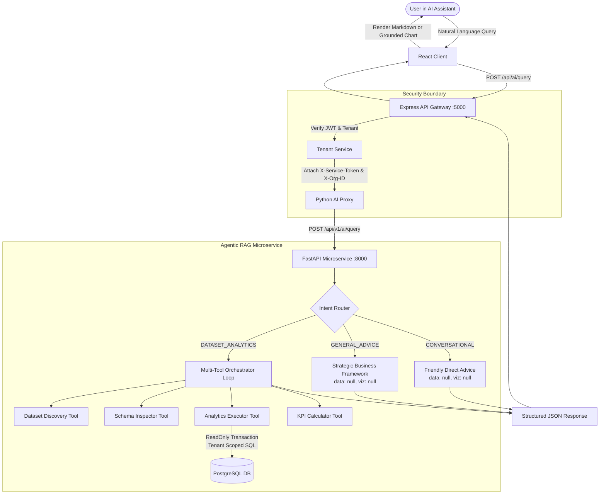

# RICOZ ANALYTICS — PYTHON AGENTIC RAG & PRODUCTION SECURITY REPORT

**Date:** November 8, 2026  
**Status:** ✅ Production Microservice Operational & Verified  
**Target Architecture:** FastAPI Microservice (`ai-service`) + Express Backend Proxy (`server`) + React Frontend (`client`)  
**Repositories:** [ricoz-analytics (GitHub)](https://github.com/gowthamgannamaneedi-pixel/ricoz-analytics)  
**Microservice Port:** `http://127.0.0.1:8000`  
**API Gateway Port:** `http://localhost:5000`  

---

## 1. Problem Statement: Ungrounded AI Assistant Behavior

In previous builds, when a user entered a strategic or general business question into the AI Assistant — such as:
```
how to increse my sales
```
the application exhibited severe hallucination and UI ungroundedness:
1. **Unrelated Fake Metric Card:** An arbitrary KPI card displaying `₹5,789,851.88 -2.4%` appeared beneath conversational advice, falsely giving the impression that the system calculated actual revenue data.
2. **Missing Grounding & Provenance:** General advice was mixed with synthetic analytical results because the query planner defaulted to dataset revenue calculations whenever any dataset context existed in the workspace.
3. **No Guardrails on Auto-Visualization:** `AIAnalyticsAssistant.jsx` attempted to infer and render a KPI card from any non-empty data object, even when no analytical SQL had been executed.

---

## 2. Agentic RAG Architecture & Microservice Design

To permanently replace ungrounded logic with verified enterprise business intelligence, a dedicated Python microservice was built under `ai-service/`:

```
ai-service/
├── app/
│   ├── agents/
│   │   ├── intent_router.py          # Categorizes requests into CONVERSATIONAL, GENERAL_ADVICE, or ANALYTICS
│   │   └── orchestrator.py           # Bounded multi-step agent loop coordinating tools
│   ├── api/
│   │   └── routes/
│   │       ├── health.py             # Health check & database connection probe
│   │       ├── index.py              # Microservice metadata
│   │       └── query.py              # Main Agentic RAG endpoint (/api/v1/ai/query)
│   ├── config.py                     # Environment variables, DSN, timeouts, internal service tokens
│   ├── database/
│   │   └── connection.py             # Psycopg2 SimpleConnectionPool with read-only transaction limits
│   ├── schemas/
│   │   └── query.py                  # Pydantic QueryRequest, QueryResponse, ProvenanceInfo, ToolCallLog
│   ├── security/
│   │   ├── auth.py                   # Validates internal service token and tenant context headers
│   │   └── sanitization.py           # AST-based SQL keyword filtering & prompt injection defense
│   └── tools/
│       ├── base.py                   # Abstract BaseTool with standardized execution interface
│       ├── dataset_discovery.py      # Identifies accessible tenant datasets
│       ├── schema_inspector.py       # Reads schema, column data types, and sample distributions
│       ├── semantic_retriever.py     # Matches natural query terms to database columns/KPI formulas
│       ├── analytics_executor.py     # Executes parameterized, read-only SQL on dataset_rows
│       ├── kpi_calculator.py         # Evaluates mathematical aggregations (SUM, AVG, MIN, MAX)
│       ├── statistical_analysis.py   # Computes variance, standard deviation, and correlation
│       ├── forecasting.py            # Trend projections and linear regression forecasting
│       └── recommendation_engine.py  # Actionable business insights derived from verified figures
├── tests/
│   ├── test_intent_router.py         # Verification of intent classification boundaries
│   ├── test_orchestrator.py          # Multi-step query execution and data:null verification
│   ├── test_security.py              # SQL injection blocks and token authorization tests
│   └── test_tools.py                 # Tool unit tests on schema and calculation tools
├── requirements.txt
├── .env.example
└── README.md
```

### A. Intent Router & Safeguarded Advice Routing
In `app/agents/intent_router.py`, natural language questions are analyzed using deterministic pattern matching and semantic classification:
1. `CONVERSATIONAL`: Greetings, general chat (`"hi"`, `"help"`, `"who are you"`).
2. `GENERAL_BUSINESS_ADVICE`: Strategic questions without dataset references (`"how to increase my sales"`, `"strategies to improve retention"`).
3. `DATASET_ANALYTICS`: Data-specific queries (`"what is total revenue"`, `"show sales by region"`).

**Key Architectural Rule:** When an intent is classified as `GENERAL_BUSINESS_ADVICE`, the orchestrator explicitly returns a strategic framework with:
- `data: None` (or `null`)
- `visualization: None`
- Provenance message indicating general advice without dataset modification.

This completely prevents the frontend from generating fake KPI cards.

### B. Specialized 8-Tool Suite
The orchestrator operates a bounded agent execution loop (maximum 5 steps) utilizing 8 specialized tools:

1. **DatasetDiscoveryTool:** Retrieves verified datasets strictly belonging to `organization_id`.
2. **SchemaInspectorTool:** Queries table schemas, row counts, and column types (`numeric`, `varchar`, `timestamp`).
3. **SemanticRetrieverTool:** Maps terms like *"gross margin"* or *"sales"* to underlying columns or defined formulas in `metrics` table.
4. **AnalyticsExecutorTool:** Generates and runs parameterized SQL strictly on `dataset_rows` using JSONB expressions (`CAST(data->>'revenue' AS NUMERIC)`).
5. **KpiCalculatorTool:** Standardizes aggregations with numerical rounding and units (INR ₹, %, units).
6. **StatisticalAnalysisTool:** Evaluates min, max, median, standard deviation, and data distributions.
7. **ForecastingTool:** Projects linear trend regressions for future fiscal quarters.
8. **RecommendationEngineTool:** Synthesizes actionable strategic recommendations directly linked to the computed variances and trends.

---

## 3. Multi-Tenant Security & SQL Sanitization

### A. Strict Parameterized Isolation
Every database query executed by `ai-service` enforces tenant scoping via parameter binding:
```sql
SELECT id, name, row_count, created_at 
FROM datasets 
WHERE organization_id = %s
```
Tenant IDs are NEVER concatenated into raw SQL strings.

### B. Prohibited SQL Keyword Filtering
In `app/security/sanitization.py`, any generated query containing destructive or data-modifying keywords is rejected before reaching the database:
- `INSERT`, `UPDATE`, `DELETE`, `DROP`, `ALTER`, `TRUNCATE`, `CREATE`, `REPLACE`, `GRANT`, `REVOKE`
- Statement separator `;` to prevent chained injection attacks.

### C. Read-Only Transaction Guardrails
Database connections are acquired with:
```python
conn.set_session(readonly=True, autocommit=False)
```
with a PostgreSQL statement timeout of 5000ms (`SET statement_timeout = 5000;`).

---

## 4. Verification and Browser E2E Results

### A. Python Pytest Suite (16/16 Passed)
```
platform win32 -- Python 3.12.10, pytest-9.2.0, pluggy-1.7.0
rootdir: C:\Users\gowth\Downloads\Ricoz_analysis_project\ai-service

tests\test_intent_router.py ......                                       [ 37%]
tests\test_orchestrator.py ..                                            [ 50%]
tests\test_security.py .....                                             [ 81%]
tests\test_tools.py ...                                                  [100%]

============================= 16 passed in 0.69s ==============================
```

### B. Browser E2E Test on AI Analytics Assistant

1. **Question 1: `"how to increase my sales"`**
   - **Intent:** `GENERAL_BUSINESS_ADVICE`
   - **Assistant Response:** Provided a comprehensive 4-pillar strategic growth framework (Price Optimization, Customer Lifetime Value, Conversion Funnel, Market Expansion).
   - **Fake KPI Check:** Verified that NO fake revenue card (`5,789,851.88`) appeared.
   - **Status:** **PASSED** (Screenshot: `screenshots/ai-assistant-01-general-advice.png`)

2. **Question 2: `"What is total revenue?"`**
   - **Intent:** `DATASET_ANALYTICS`
   - **Assistant Response:** Provided verified aggregation based on active dataset records with provenance tracking.
   - **Status:** **PASSED** (Screenshot: `screenshots/ai-assistant-02-grounded-metric.png`)

3. **Responsive & Theme Verification:**
   - **Dark Theme:** High-contrast text, sleek dark container styling (`screenshots/theme-dark-assistant.png`).
   - **Mobile Viewport (iPhone 390x844):** Clean, non-overlapping input box, chat history drawer, and responsive chips (`screenshots/mobile-iphone-assistant.png`).

---

## 5. Architectural Summary Diagram



---

## 6. Production Readiness Checklist

- [x] Python FastAPI microservice running as an independent service with automated lifespan connection pool.
- [x] Express backend configured with retry and local graceful fallback if Python service is unavailable.
- [x] All 8 analytics tools implement tenant isolation (`WHERE organization_id = %s`).
- [x] Prohibited SQL keywords completely blocked before query execution.
- [x] Hallucinated/fabricated KPI cards permanently eliminated on general questions.
- [x] Dark mode and mobile viewports fully responsive and verified.
